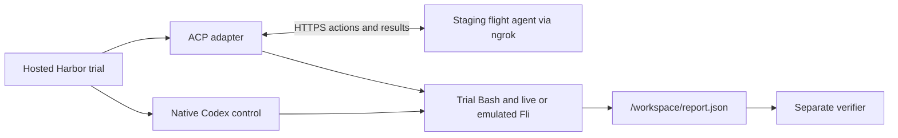

# Building Remote Evals with Harbor

Capture the flight inventory once, then use the same agent workflow with either
a live Fli server or an emulated one. Hosted Harbor gives each trial its own
workspace and grades the report in a separate verifier.

## Capture a flight snapshot

```sh
uv run --locked python harbor/task/capture_fli.py \
  --origin SFO --destination JFK --output jobs/fli-snapshot.json
```

The command defaults to three consecutive dates starting 21 days ahead in UTC.
Use `--start-date YYYY-MM-DD` and `--days 2` through `--days 7` to choose a
different window. It asks the pinned Fli backend for every returned one-way
economy nonstop for one adult in USD, then checks each day's lowest fare against
Fli's date search. It writes the snapshot and prints its SHA-256 only after
every date passes. Each file records the capture time, query scope, Fli version,
and offer counts. [Fli MCP reference](https://punitarani.github.io/fli/guides/mcp/)

The example uses the checked-in [SFO–JFK snapshot](harbor/task/fixtures/sfo-jfk.json).
To refresh it, review the capture and replace that file in the release commit.
The emulated server and verifier both receive the same snapshot bytes. The
snapshot covers the requested dates and the offers Fli returned within the
query scope.

## Run the two Harbor examples

Start [staging and ngrok](#connect-staging) and set the credentials described there.

```sh
uv run --locked --env-file .env python -m scripts.run_eval --suite smoke
uv run --locked --env-file .env python -m scripts.run_eval --suite live-smoke --target remote
```

| Suite | Fli tools | What the verifier checks |
| --- | --- | --- |
| `smoke` | Emulated from the checked-in snapshot | Exact cheapest date, nonstop flight, and fare |
| `live-smoke` | Live Fli MCP, with a fresh date window | A valid found itinerary within the requested route and date range |

The emulated server reuses Fli's MCP handlers and replaces their network
searches with a read of the captured inventory. It freezes the Fli clock at
capture time so the same dates remain valid on later runs. Date prices and
flight rows come from the same data, and requests outside the captured route,
dates, or nonstop scope return an error.
A pinned snapshot gives each run the same initial inventory, supported tool
responses, and reward for a given report. A model may still choose a different
sequence of actions.

The live trial allows the Fli upstream host and checks the report contract
without pinning a fare. Inspect its trajectory for successful
`search_dates` and `search_flights` responses. The separate verifier stays
offline in both suites. [Harbor network policies](https://docs.harborframework.com/tasks/network-policies) · [Harbor separate verifier](https://docs.harborframework.com/tasks/separate-verifier)

## Move tool execution behind one interface

The [starting commit](https://github.com/punitarani/remote-evals/commit/ab72dd7)
calls live Fli and invokes Bash directly. The [harness](agent/harness.py) still
owns the system prompt, model loop, tool schemas, and tool budget. The application
now chooses the executor when it creates a run.

```diff
-async def run_agent(prompt, complete, workspace):
+async def run_agent(prompt, complete, executor):
     ...
-    result = await run_bash(command, workspace)  # or call_fli(name, arguments)
+    result = await executor.execute(name, arguments)
```

The [local CLI](agent/__main__.py) uses `DirectToolExecutor` for live Fli and Bash.
The [staging service](agent/service.py) sends actions to the
[ACP adapter](harbor/adapter/), which invokes Fli in the trial over MCP and
executes Bash through Harbor's terminal API. Each trial has its own workspace.
Repeating an action result returns the same response, and the adapter reuses
the result of a completed action.



## Connect staging

Use Python 3.14 with uv for the service, capture script, and task image. The
GitHub-sourced ACP adapter has its own Python 3.12 lockfile for Hosted Harbor.
For a fork, set `REPOSITORY` in the [launcher](scripts/run_eval.py) and grant
Harbor access if the fork is private. [Harbor custom agents](https://docs.harborframework.com/hosted-harbor/custom-agents)

Copy `.env.example` to `.env` if you need a template. Set
`OPENROUTER_API_KEY` for staging, `CODEX_OPENROUTER_API_KEY` for Codex, and
`BRIDGE_TOKEN` to a random value. Run `uv run --locked harbor auth login`
locally or set `HARBOR_API_KEY`. From a clean checkout of the deployment
commit, start staging in one terminal and ngrok in another.

```sh
AGENT_RELEASE="$(git rev-parse HEAD)" \
  uv run --locked --env-file .env python -m agent.service
```

```sh
ngrok http http://127.0.0.1:8000 --inspect=false
```

Set `STAGING_URL` in `.env` to the HTTPS forwarding origin. Keep both
processes running through the last trial. The launcher checks the deployed
commit at `/healthz` and dry-runs the pinned adapter source. Both targets
default to `deepseek/deepseek-v4.1-flash-1017` on OpenRouter. The OpenAI gateway
option requires `CODEX_OPENAI_API_KEY` and an explicit
`--codex-provider openai --codex-model` model selection.

## CI and offline checks

Configure the GitHub Actions `staging` environment with the `STAGING_URL`
variable and the `HARBOR_API_KEY`, `BRIDGE_TOKEN`, and
`CODEX_OPENROUTER_API_KEY` secrets. A successful staging deployment triggers
the emulated suite. Use **Actions → Hosted Harbor eval → Run workflow** to
select `live-smoke` manually. The launcher prints the job URL and downloads
the traces, reports, and `eval-summary.json` under `jobs/`.

```sh
uv run --locked --group fixture pytest -q
uv --directory harbor/adapter run --locked pytest -q
uv run --locked ruff check .
uv run --locked ruff format --check .
```

## Verified Hosted Harbor runs

Both jobs used [release `b60dcc5`](https://github.com/punitarani/remote-evals/commit/b60dcc5a96673fcba80b64eb374d472b8828242c).
The emulated job used 62 offers from December 2–4, 2026. The snapshot SHA-256 was
`65c04a06b021e822862ba94ee225fb21ce74dd5954a58962a212f2878ef36f92`.

| Run | Result |
| --- | --- |
| [Emulated Fli](https://hub.harborframework.com/jobs/bf3f7bc8-a478-4601-93eb-b828128f7d2d) | Codex and the staging agent both wrote the same report for AA166 on December 3 at $174.00. Each earned 1.0 using the same task checksum. |
| [Live Fli](https://hub.harborframework.com/jobs/b984ee9f-65a1-490f-8145-1172da16c56d) | The staging agent received three dates and 21 offers from live Fli. Its report passed the itinerary contract check. |
