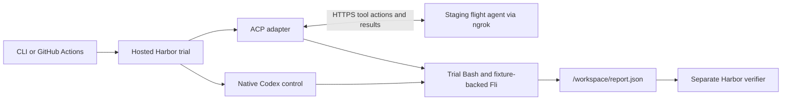

# Building Remote Evals with Harbor

Take a flight agent that already calls Bash and Fli, then let Hosted Harbor
supply the workspace, flight inventory, and grader for a single run. The
example staging service runs on your machine and is reachable over HTTPS
through ngrok.



## 1. Start with the direct-call agent

The [starting commit](https://github.com/punitarani/remote-evals/commit/ab72dd7)
runs a model loop, calls live Fli handlers, and invokes Bash in the workspace
supplied at launch. To try live Fli, supply `OPENROUTER_API_KEY` in `.env` and
run the CLI in a disposable workspace.

```sh
uv sync --locked --group fixture
uv run --locked --env-file .env python -m agent --workspace "$(mktemp -d)" \
  "Use Fli to find a one-way nonstop from SFO to JFK next month and summarize the fares."
```

## 2. Move tool execution behind one interface

The [harness](agent/harness.py) still owns the system prompt, model loop, tool
schemas, and tool budget. The application chooses the executor when it creates
a run. The change at the point of execution is the migration to copy.

```diff
-async def run_agent(prompt, complete, workspace):
+async def run_agent(prompt, complete, executor):
     ...
-    result = await run_bash(command, workspace)  # or call_fli(name, arguments)
+    result = await executor.execute(name, arguments)
```

The [CLI](agent/__main__.py) injects `DirectToolExecutor(workspace)`. The
[staging service](agent/service.py) injects a trial executor that returns the
next action to the [ACP adapter](harbor/adapter/). The adapter executes Bash
through Harbor's terminal API or invokes Fli over MCP, then posts the result
back. Each trial has its own session. Repeating a start request or an action
result returns the same response, and the adapter reuses the result of a
completed action.

## 3. Build and check the Harbor task

```sh
uv run --locked --group fixture pytest -q
uv run --locked ruff check .
uv run --locked ruff format --check .
uv lock --check
uv --directory harbor/adapter lock --check
uv --directory harbor/adapter run --locked pytest -q

task_dir=$(mktemp -d)
uv run --locked python harbor/task/package.py "$task_dir" --suite full
uv run --locked harbor lint "$task_dir/cheapest-nonstop"
uv run --locked harbor lint "$task_dir/no-match"
```

The smoke case has a cheaper connection and tied nonstop fares. The second
case has no eligible flight. Both use the pinned Fli handlers with synthetic
inventory and a fixed clock. Harbor copies `/workspace/report.json` to a fresh
verifier container, where [the grader](harbor/task/verify.py) checks the exact
JSON contract and writes a binary reward. The model sees the same workspace,
Fli tools, and report contract in both eval targets. Codex also has its native
workspace capabilities. [Harbor separate verifier](https://docs.harborframework.com/tasks/separate-verifier)

## 4. Run the control and connect staging

Use Python 3.14 for the service, developer tooling, and task image. Harbor
currently requires Python 3.12 for a GitHub-sourced ACP adapter, so the adapter
has its own manifest and lockfile. The task image also pins the ACP SDK used by
Harbor's runner bootstrap. If you run from your own fork, set `REPOSITORY` in
[the launcher](scripts/run_eval.py). For a private fork, grant the Harbor
Connect GitHub App access to that repository and share it with the Harbor
organization that owns the job. [Harbor custom agents](https://docs.harborframework.com/hosted-harbor/custom-agents)

Copy `.env.example` to `.env` if you need a template. Set `OPENROUTER_API_KEY`
for staging, `CODEX_OPENROUTER_API_KEY` to a separate scoped key for Codex, and
`BRIDGE_TOKEN` to a random value such as one generated by
`uv run python -c 'import secrets; print(secrets.token_urlsafe(32))'`.
Run `uv run --locked harbor auth login` locally or set `HARBOR_API_KEY` for CI.

Run the native Codex control first.

```sh
uv run --locked --env-file .env python -m scripts.run_eval --target codex
```

From a clean checkout of the deployment commit, start staging in one terminal
and ngrok in another. Keep both running through the last trial.

```sh
AGENT_RELEASE="$(git rev-parse HEAD)" \
  uv run --locked --env-file .env python -m agent.service
```

```sh
ngrok http http://127.0.0.1:8000 --inspect=false
```

Put the HTTPS forwarding origin in `STAGING_URL` in `.env`. The staging
`/healthz` reports the deployed SHA, model, and mode. The launcher verifies the
SHA and runs a Harbor dry run against the pinned adapter source.

For a credential-free inference check, start the same service with
`AGENT_MODE=scripted`. This probe uses Harbor's ACP runner to request one Bash
action over the ngrok URL and confirms the resulting file in a disposable
workspace. Export `STAGING_URL` and `BRIDGE_TOKEN` from your local configuration
before running it.

```sh
repo=$(pwd)
release=$(git rev-parse HEAD)
uv --directory harbor/adapter sync --locked
runner=$(uv run --locked python -c 'from importlib.util import find_spec; print(find_spec("harbor.agents.installed.acp_runner").origin)')
work=$(mktemp -d)
(
  cd "$work"
  AGENT_RELEASE="$release" REMOTE_EVAL_METADATA_PATH="$work/remote-eval.json" \
    "$repo/harbor/adapter/.venv/bin/python" -P "$runner" \
    --instruction "Run the scripted bridge check." --logs-dir "$work/agent" \
    --launcher "$repo/harbor/adapter/.venv/bin/remote-eval-adapter"
  cat bridge-probe.txt
)
```

Restart staging in model mode for scoring. Launch both targets on the same
pinned task packages.

```sh
uv run --locked --env-file .env python -m scripts.run_eval --dry-run
uv run --locked --env-file .env python -m scripts.run_eval --suite full
```

Use `--target remote` to debug the deployed agent by itself. Both targets
default to `deepseek/deepseek-v4.1-flash-1017` on OpenRouter. To use Harbor's
OpenAI gateway for the control, set `CODEX_OPENAI_API_KEY` and pass
`--codex-provider openai --codex-model` followed by an explicit `openai/` model ID.

## 5. Run it after a deploy

Configure the GitHub Actions `staging` environment with the `STAGING_URL`
variable and the `HARBOR_API_KEY`, `BRIDGE_TOKEN`, and
`CODEX_OPENROUTER_API_KEY` secrets. Point the URL at the running ngrok
endpoint. A successful `staging` deployment status starts the two-trial smoke
suite. From **Actions → Hosted Harbor eval → Run workflow**, enter the deployed
commit SHA and select `full` to run the two cases on both targets.

The launcher writes a job link and per-trial status to the CI summary. It
downloads the result and artifacts under `jobs/`, including
`eval-summary.json`. A task score of zero means the report failed grading.
Endpoint, inference, bridge, and verifier failures appear as separate
outcomes. To debug, check the verifier tests, run Codex, run the scripted
bridge probe, then inspect the model-backed run.

While a remote trial runs, Harbor appends ACP updates to
`/logs/agent/acp-events.jsonl` in the trial sandbox. The adapter checkpoints
`/logs/artifacts/remote-eval.json` at session start and around each tool call.
That file records the deployment, session, and action statuses. The ACP events
carry the tool arguments and results.

After the trial exits, Harbor converts those events to `agent/trajectory.json`
for the Hub trajectory view. Open the trial to inspect named calls such as
`search_flights` and `bash` alongside their results. The launcher checks the
trajectory's session ID and verifies that each bridge action has a named call
and linked observation. It reports trajectory problems alongside the original
reward. Harbor 0.25's [live trajectory streaming](https://docs.harborframework.com/jobs/stream)
covers Claude Code and Codex in the local viewer. Use the completed trial's
trajectory for custom ACP agents in Hosted Harbor.

Compare `remote-eval.json` with the downloaded `report.json` and verifier
diagnostic. Use the start and finish times from two remote traces to check
concurrent execution.

The [trace smoke trial](https://hub.harborframework.com/jobs/339eebd9-3892-4537-9c1d-1d05891b4ef8/trials/a849faaf-1e3f-4b94-96fe-054337fccd41)
on release `91e76e6` scored 1.0. Hub showed the running status during execution
and displayed all four named calls and their results after completion. Expand
the Bash step to see the report write and terminal exit status.

## Verified hosted run

The [full Hosted Harbor job](https://hub.harborframework.com/jobs/59eccc7a-9724-44a8-8e13-ef0160a3f4bf)
used [release `2c64dcb`](https://github.com/punitarani/remote-evals/commit/2c64dcb649874c21b961c301d538a75d31f74944)
and `deepseek/deepseek-v4.1-flash-1017` through OpenRouter for both agents.
Each case used the same task checksum for Codex and the staging agent.

| Case | Fixture SHA-256 prefix | Agent | Harbor trial ID | Reward |
| --- | --- | --- | --- | --- |
| Cheapest nonstop | `c2f8d9fc2f13` | Codex | `04cc4487-1db0-44d4-b9b8-72d241294520` | 1.0 |
| Cheapest nonstop | `c2f8d9fc2f13` | Staging | `eed2483b-9870-4ca3-8b80-0eb064bf6a1a` | 1.0 |
| No match | `6d39ea0cfb2f` | Codex | `bbdc8fee-78cf-4e2f-9f4a-4ba55147a94f` | 1.0 |
| No match | `6d39ea0cfb2f` | Staging | `1d10bd66-1bee-4ca1-9f7f-09f33a3f60b2` | 1.0 |

In the staging smoke trial, action `2` asked Fli to confirm nonstops on
May 10. The adapter returned UA208 and UA202 at $199 each. The harness chose
UA202 under the flight-number tie-break, then used Bash to write this report.
Harbor copied it into the separate verifier and awarded 1.0.

```json
{
  "status": "found",
  "origin": "SFO",
  "destination": "JFK",
  "departure_date": "2030-05-10",
  "flight_number": "UA202",
  "currency": "USD",
  "price_cents": 19900
}
```

The two staging sessions overlapped for about 2.4 seconds. They used distinct
session IDs and separate trial workspaces. The second workspace produced
`{"status":"no_match"}`.
